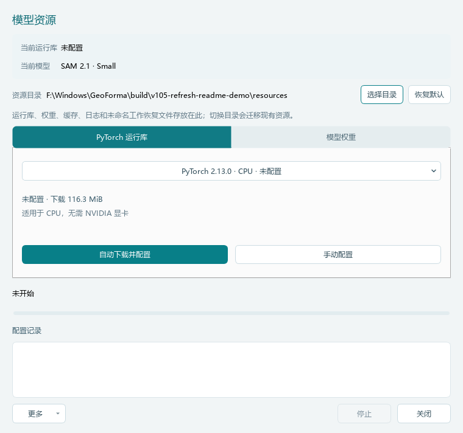
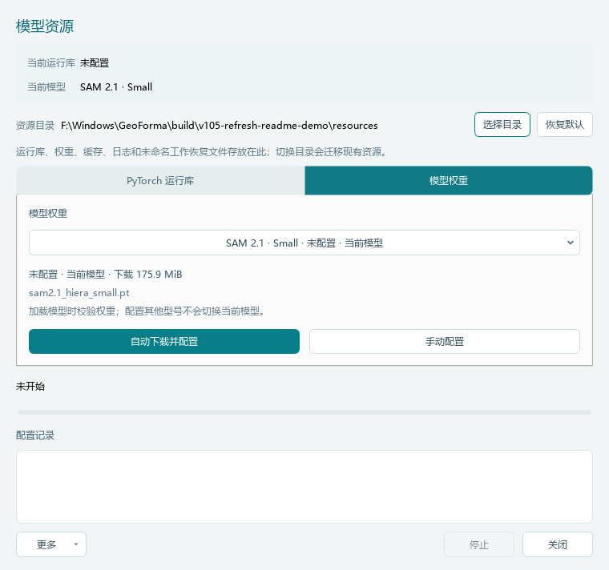
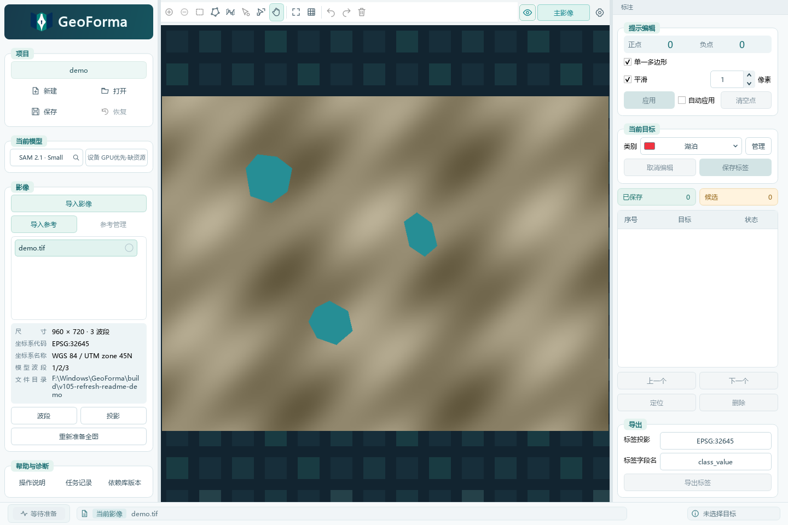
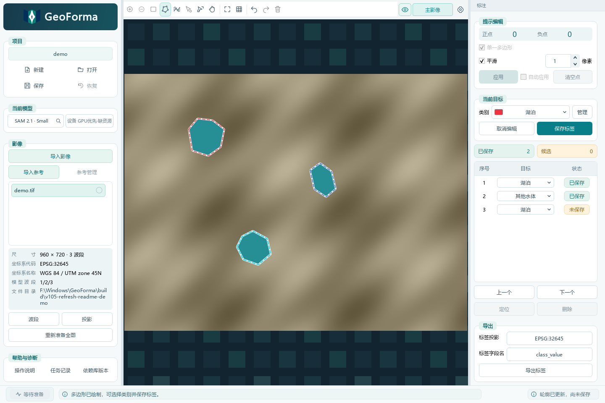
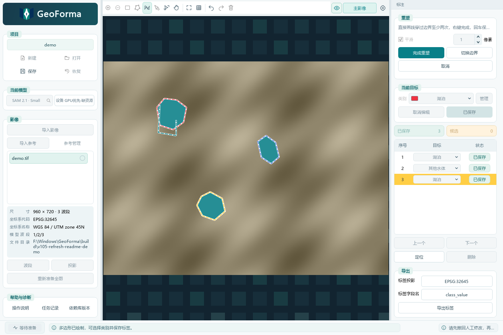
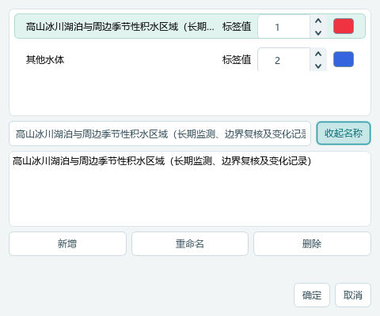
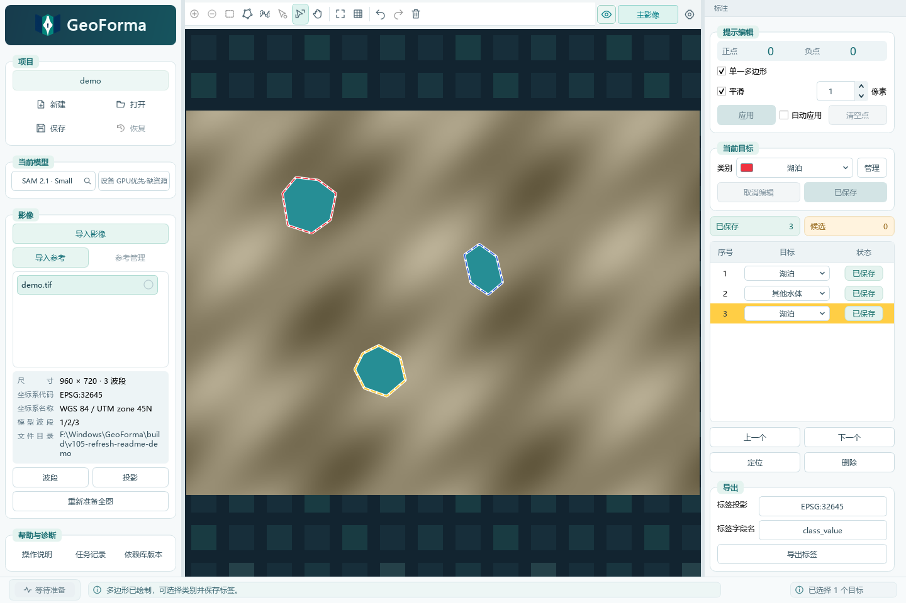

# GeoForma

GeoForma 是一款面向地理影像的 Windows 桌面标注工具，支持交互式分割、人工绘制、轮廓重塑、类别编辑与矢量导出。

## 下载与安装

**当前版本：1.0.5** · Windows 11 64 位

- [下载 GeoForma-1.0.5-win64-setup.exe](https://github.com/radiofor/GeoForma/releases/download/v1.0.5/GeoForma-1.0.5-win64-setup.exe)
- [版本说明与校验文件](https://github.com/radiofor/GeoForma/releases/tag/v1.0.5)

下载后运行单个 EXE，按向导完成安装。无需单独安装 Python、Conda 或 CUDA Toolkit；PyTorch 运行库和模型权重按需下载或导入。GPU 加速需要兼容的 NVIDIA 显卡与驱动。

更新前请保存项目并退出 GeoForma。符合安全校验条件的 1.0.4 或既有 1.0.5 安装会由向导先卸载再安装，项目和已配置资源保留；无法验证旧版位置或记录时，请按安装提示处理。

## 1.0.5 更新

本次在同一 1.0.5 版本内更新安装包与截图，包含以下列表和长名称显示优化。

- 开启平滑后，重塑期间继续显示平滑轮廓。
- 直接画重塑线即可识别目标，无需预先选中；穿过多个标注时同时编辑，右键完成后按回车统一保存。
- 未勾选“单一多边形”时，各部件保存为独立 Polygon，列表逐条显示，内部孔洞保留。
- 生成轮廓后，列表立即出现对应的“未保存”条目；保存后同一条目变为“已保存”。
- 每行类别可通过下拉框单独调整；移除“调整／编辑类别”和“全部撤销”按钮。
- 列表按钮排为上方“上一个、下一个”，下方“定位、删除”；Del 可以删除所选标注。
- 完善手绘、重塑、类别修改、部件删除、批量及混合删除的撤销／重做，加强项目和编辑历史校验。
- 列表采用紧凑行高，序号、类别和状态与表头居中对齐；状态仅以文字和配色区分。类别列获得更多宽度，长序号自动留宽。
- 长类别名称收起时省略显示，下拉列表按内容加宽；超过屏幕宽度时支持横向滚动。类别管理可展开查看、复制完整名称，编辑和保存不截断长名称。

## 使用流程

### 1、配置运行库和模型

在右上角“设置 → 资源配置”中配置推理资源：

1. 如需将资源放在其他磁盘，先点击“选择目录”。切换位置会迁移现有受管理资源。
2. 在“PyTorch 运行库”页选择 CPU 或 NVIDIA GPU 版本，点击“自动下载并配置”；已有对应文件时也可以“手动配置”。
3. 在“模型权重”页选择需要的型号，下载或导入对应权重。配置其他型号不会自动切换当前模型。

| PyTorch 运行库 | 模型权重 |
| --- | --- |
|  |  |

截图为隔离的示例环境，路径仅用于演示。已配置资源可离线使用；人工绘制不需要模型推理。

### 2、导入影像并保存项目

1. 点击“导入影像”，选择 TIF、TIFF 或 VRT 文件。VRT 会展开为各幅影像，供逐幅处理。
2. 检查坐标系、模型波段；按需通过“波段”或“投影”设置。
3. 点击左上角“保存”，保存项目。原始影像不会复制进项目，移动项目时请保留源影像和参考影像。
4. 需要参考影像时，使用“导入参考”；参考影像只用于查看，不参与模型计算。

### 3、创建标注并确认保存

模型资源就绪后，在工具栏选择正点、负点或框选。正点表示目标内部，负点用于排除区域，框选用于限定范围。关闭“自动应用”时，点击“应用”更新结果。

也可使用“绘制”：左键逐点添加顶点，右键或双击完成多边形。**轮廓创建后，右侧立即显示对应的“未保存”条目**；检查类别和轮廓后按回车，或点击“保存标签”。

“单一多边形”开启时只保留一个连通轮廓；关闭时保留多个部件，每个部件在列表中分别显示，确认保存后成为独立标注。孔洞仍保留在所属多边形中。

### 4、直接重塑轮廓

选择“重塑”工具后直接绘制编辑线，**无需先选中标注**。编辑线需穿过同一个目标外边界至少两次；穿过多个标注时会同时重塑。

右键或点击“完成重塑”后，结果暂存为草稿。按回车统一保存，状态改为“已保存”。开启平滑时保持平滑显示。表格选中只用于对应高亮，不决定重塑目标。

### 5、逐行修改类别、定位与删除

- 每行“目标”列都是类别下拉框，可逐条调整。已保存标签的类别修改立即生效，并可撤销；未保存标注的类别随回车确认。
- 点击序号可以选中对应轮廓；双击列表行或点击“定位”查看目标。
- “上一个／下一个”切换对应目标并定位，保留当前草稿。
- 点击“删除”或按 **Del** 删除所选标注；**Ctrl+Z 或工具栏“撤销”可以恢复**，Ctrl+Shift+Z 可以重做。

序号列按位数留宽，状态列保留完整文字及滚动条间距，类别列使用其余空间。类别下拉框收起时省略长名称，展开后可查看全文；超过屏幕宽度时可横向滚动。

点击“管理”修改类别名称、标签值和颜色。选中类别后可在名称输入框编辑完整名称，点击“展开名称”查看、复制全文。长名称不会因输入框显示宽度而被截断保存。

### 6、保存项目与导出

1. “保存标签”确认标注结果；左上角“保存”保存整个项目与工作状态。
2. 在右下角检查投影和标签字段名，点击“导出标签”，选择 GPKG、SHP 或 GeoJSON。
3. 仅导出当前影像已确认保存的标注；拆分后的多边形分别成为独立要素。SHP 字段名最多 10 个 UTF-8 字节。

## 常用快捷键

| 按键 | 操作 |
| --- | --- |
| Enter / Return | 确认保存已完成的标注或重塑结果 |
| Ctrl+Z | 撤销当前上下文最近的操作，包括删除 |
| Ctrl+Shift+Z | 重做 |
| Ctrl+Alt+Z | 逐步撤回标签操作 |
| Del | 删除所选标注；画布选中提示点时删除提示点 |
| Backspace | 在绘制或重塑画布中撤回一个点 |
| Esc | 取消当前编辑或构建 |
| 中键拖动 | 平移影像 |

文本输入框保留自身的字符编辑行为。正在处理、编辑线未完成或提示结果待应用时，不会提前保存。

全部截图由 **GeoForma 1.0.5 的实际 Qt 界面重新截取**。影像为合成示例，标注为人工绘制，用于说明界面操作，不代表模型推理结果或分割精度。更多说明可在软件左下角“操作说明”查看。

## 隐私政策与反馈

查看 [隐私政策](PRIVACY.md)。如需反馈问题，请使用 [Issues](https://github.com/radiofor/GeoForma/issues)，不要在公开反馈中提交个人信息、密码或未经脱敏的数据。
