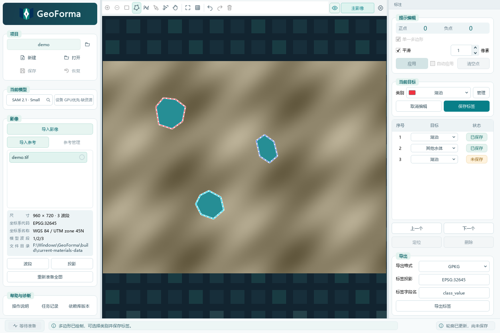
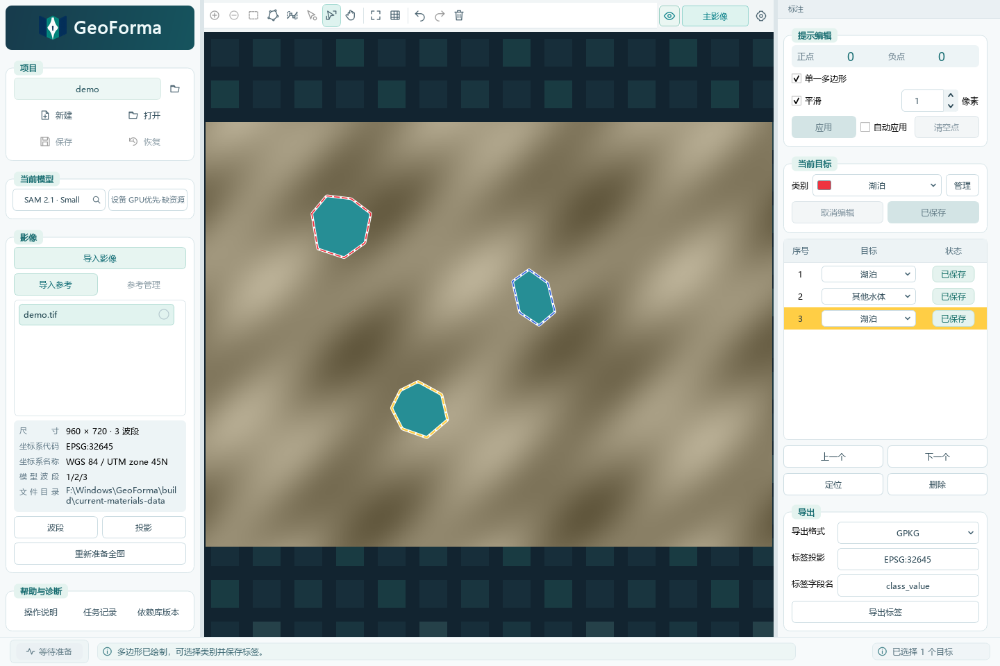

# GeoForma

GeoForma 是 Windows 地理影像交互标注工具，支持模型辅助分割、手动绘制、轮廓重塑、类别管理和矢量标签导出。

## 下载与安装

当前版本为 **1.0.5**，适用于 Windows 11 64 位。下载 [GeoForma 安装程序](https://github.com/radiofor/GeoForma/releases/download/v1.0.5/GeoForma-1.0.5-win64-setup.exe)，并在 [发布页面](https://github.com/radiofor/GeoForma/releases/tag/v1.0.5)查看校验值。

首次使用分割功能前，在“设置 → 资源配置”下载或导入推理运行库和所需模型权重。支持 SAM 1、SAM 2、SAM 2.1 和 SAM 3；推理在本地执行。

## 使用流程

1. 导入 TIF、TIFF 或 VRT 影像，检查坐标系和模型波段。
2. 选择类别，通过正负提示点、框选或手动画多边形创建标注；按 Enter 或点击“保存标签”确认。
3. 直接绘制穿过边界的线重塑标注；穿过多个标注时可同时编辑，完成后按 Enter 保存。
4. 在列表中逐条修改类别、定位或删除。按 Del 删除所选标注，Ctrl+Z 撤销，Ctrl+Shift+Z 重做。
5. 首次保存项目时选择 `.gfm` 文件位置，之后项目更改自动写回；未命名项目可通过恢复功能找回。
6. 选择 GPKG、SHP 或 GeoJSON 导出已确认标签；GeoJSON 固定使用 EPSG:4326。

项目和数据可存放在不同目录。数据移动后，打开项目时可重新指定路径或移除缺失数据；项目文件移动后，可从新位置打开。资源配置支持更改模型和缓存目录。

截图来自当前软件界面，影像为合成示例，标注为手工绘制，不代表模型推理效果。更多操作说明见 [用户指南](docs/USER_GUIDE.txt)。

## 源码与验证

源码环境配置见 [开发环境说明](environment/README.txt)。在配置好的 GeoForma Python 环境中运行 `python main.py`；自动化检查运行 `python tools/run_checks.py`，依赖检查运行 `python tools/check_dependencies.py`。

隐私政策见 [PRIVACY.md](store-materials/geoforma-privacy/PRIVACY.md)，问题反馈请使用 [GitHub Issues](https://github.com/radiofor/GeoForma/issues)。
